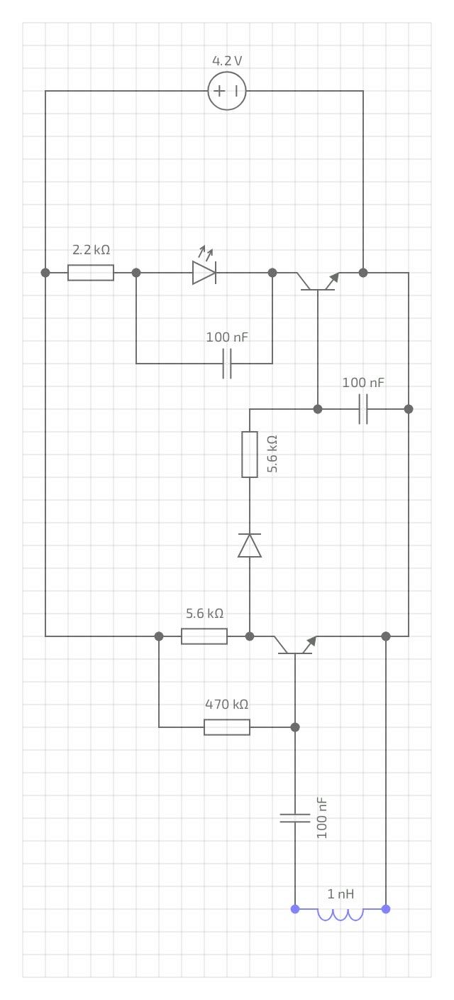

# Non-Contact Coil / Inductor / Transformer Tester

A tiny, battery-powered circuit that senses the **changing magnetic field** around a coil, inductor or transformer from a distance and shows the result on an LED. No probes, no touching the part, no microcontroller. Just two transistors and a few cheap parts.


**LinkedIn post:** [](https://lnkd.in/p/gc8iCuZy)

---

## Table of contents

1. [What is this project?](#what-is-this-project)
2. [Features](#features)
3. [Circuit diagram](#circuit-diagram)
4. [How it works: the simple version](#how-it-works-the-simple-version)
5. [How it works: the deep dive](#how-it-works-the-deep-dive)
6. [Parts list](#parts-list)
7. [Why these component values?](#why-these-component-values)
8. [Power consumption and battery life](#power-consumption-and-battery-life)
9. [How to use it](#how-to-use-it)
10. [Checking the signals with an oscilloscope](#checking-the-signals-with-an-oscilloscope)
11. [Troubleshooting and tuning](#troubleshooting-and-tuning)
12. [Limitations](#limitations)
13. [Safety](#safety)
14. [Build tips](#build-tips)
15. [Future improvements](#future-improvements)
16. [Repository structure](#repository-structure)
17. [Author and license](#author-and-license)

---

## What is this project?

Coils, inductors and transformers are hard to check by eye. A winding can look perfect and still be open or damaged inside. A multimeter needs you to touch the leads, and often to desolder the part.

This tester uses a **sensing coil** at the tip of the board. You bring the tip close to the part under test, and the circuit picks up the part's magnetic field through the air. If a changing field is present, the LED lights up.

It is a learning project and a quick-check tool. It is also a good way to understand how a simple transistor circuit can detect, amplify and display a very small signal.

## Features

- **Non-contact.** Sensing happens through the air, so you never touch the part.
- **Simple.** 2 transistors, 1 diode, 1 LED, 4 resistors, 3 capacitors and a coil.
- **Low power.** About 0.7 mA idle and about 1.2 mA with the LED lit (calculated estimates).
- **Portable.** A single 4.2 V Li-ion cell and a push switch, built on perfboard.
- **Cheap.** Every part is common and easy to find.

## Circuit diagram



> The 1 nH inductor in the drawing is only a **placeholder** for the sensing coil. In the real build it is a small hand-wound coil on a ferrite core at the tip of the board.

---

## How it works: the simple version

Think of the circuit as four small blocks. Each one passes its result to the next:

```
Sensing coil  ->  Amplifier  ->  Detector  ->  LED driver  ->  LED
 (listens)      (Q1: makes     (diode +      (Q2: switches
                 it louder)     capacitor)    the LED on)
```

1. **The coil listens.** A changing magnetic field creates a tiny voltage in it, a bit like a microphone for magnetic fields.
2. **Q1 reacts.** It is biased right at the edge of switching, so even a tiny voltage flips it.
3. **The diode and capacitor collect the result.** They turn short pulses into a steady voltage.
4. **Q2 lights the LED.** Once the steady voltage is high enough, the LED switches on.

**No field means LED off. Field present means LED on.**

---

## How it works: the deep dive

### 1. The physics: what the coil senses

When the magnetic flux through a coil changes, a voltage is induced in it (Faraday's law):

```
e = -N x dPhi/dt
```

- `N` is the number of turns in the sensing coil.
- `dPhi/dt` is how fast the magnetic field through the coil is changing.

Two important consequences:

- **Only a changing (AC) field makes a signal.** A steady field, such as a static magnet or DC through a coil, produces no voltage.
- **Faster change gives a bigger signal.** The induced voltage grows with frequency, so a switching-supply transformer at tens of kHz induces far more voltage than a 50 Hz mains transformer of the same strength.

So the tester detects a coil, inductor or transformer that **is carrying an AC current** and therefore radiating an AC magnetic field.

### 2. The idle state (no field): Q1 is switched hard on

Look at the bottom transistor, **Q1**:

- **R4 (470 kΩ)** connects from the + rail to Q1's base. It supplies a small, fixed base current:
  ```
  I_B = (4.2 V - 0.65 V) / 470 kΩ  =  about 7.5 µA
  ```
- With a typical gain (beta) of about 200, Q1 *wants* to pass `beta x I_B = about 1.5 mA`.
- But the collector resistor **R2 (5.6 kΩ)** can only let through about `(4.2 - 0.15) / 5.6 kΩ = about 0.72 mA`.
- Q1 is asked for more current than the circuit allows, so it **saturates**: it is switched fully on and its collector sits very low, around **0.1 to 0.3 V**.

The diode **D1** is connected from Q1's collector toward Q2's base. It needs roughly `0.6 V (diode) + 0.65 V (Q2 base-emitter) = 1.25 V` at the collector before any current can flow. At 0.2 V nothing flows, so **Q2 stays off and the LED stays off**.

Idle supply current is therefore about **0.7 mA**, almost all of it flowing through R2 and Q1.

The key design idea is that **Q1 is deliberately biased right at the edge of saturation**. Its base current only just keeps it saturated, so a very small disturbance is enough to push it out of saturation.

### 3. When a field arrives: Q1 starts to switch off

The sensing coil is connected between Q1's base (through **C1, 100 nF**) and the − rail.

- **C1 blocks DC** so the coil's tiny DC resistance does not upset the bias, but it **passes the AC voltage** from the coil.
- The AC voltage from the coil adds to Q1's base voltage.
- Q1's base-emitter junction behaves like a diode, and the coil voltage swings it up and down around the bias point.
- On the **positive half-cycles** the base-emitter junction conducts and charges C1 a little. On the **negative half-cycles** the base is pulled below its resting level.
- When the base current drops below roughly `0.72 mA / beta = about 3.6 µA`, Q1 leaves saturation. A little further and it cuts off completely.
- While Q1 is off, nothing pulls the collector down, so R2 pulls it **up toward the supply (4.2 V)**.

So each cycle of the sensed field produces a **positive pulse at Q1's collector**. Stronger fields make wider and taller pulses.

Because Q1 sits on the knife-edge of saturation, even a coil voltage of a few tens of millivolts is enough to produce clear pulses.

**Frequency response.** The coil and C1 are connected in series, so they form a **series resonant circuit**:

```
f0 = 1 / (2 x pi x sqrt(L x C1))
```

For example, a 10 mH coil with 100 nF resonates near 5 kHz, and a 1 mH coil near 16 kHz. The tester is most sensitive around this region. It still responds at other frequencies, but less strongly.

### 4. The detector: turning pulses into a steady voltage

Q1's collector pulses go through **D1**, then **R3 (5.6 kΩ)**, into **Q2's base** and the hold capacitor **C2 (100 nF)**:

- **D1** passes only the high (positive) collector voltage, and blocks the low idle level. That is why the LED stays off with no signal.
- Each pulse pushes a little current through R3 and charges **C2**.
- When Q1 turns on again, the diode blocks, so C2 cannot drain back into Q1. C2 can only discharge slowly through Q2's base.
- C2 therefore acts like a small bucket. Pulses fill it, and it empties slowly, so the voltage looks like a **steady DC level** instead of fast pulses. The hold time is a few milliseconds, which is long enough that the LED looks steady to the eye.
- R3 also limits the current into Q2's base to protect it.

### 5. The LED driver

When C2 charges to about **0.6 to 0.65 V**, **Q2** (the top transistor) turns on:

- Current flows from + through **R1 (2.2 kΩ)**, the **LED** and Q2 to the − rail.
- R1 sets the LED current:
  ```
  I_LED = (4.2 V - V_LED - 0.1 V) / 2.2 kΩ
  ```
  For a green LED (about 2.0 to 3.0 V) this is roughly **0.5 to 0.9 mA**, which is enough to light a modern LED clearly.
- **C3 (100 nF)** sits across the LED. It smooths the current pulses so the LED does not flicker.

A stronger field gives wider pulses, so C2 charges higher and the LED gets brighter. The LED changes from off to on fairly sharply once the threshold is crossed.

### 6. Summary of the two states

| State | Q1 | Q1 collector | D1 | Q2 | LED |
|---|---|---|---|---|---|
| **No field** | Saturated (on) | About 0.1 to 0.3 V (flat) | Blocked | Off | **OFF** |
| **AC field present** | Switches off during part of each cycle | Positive pulses toward 4.2 V | Conducts on pulses | On | **ON** |

---

## Parts list

| Ref | Part | Value | What it does |
|---|---|---|---|
| Q1 | NPN transistor | General purpose small-signal (TO-92) | Amplifier / sensor |
| Q2 | NPN transistor | General purpose small-signal (TO-92) | LED switch |
| D1 | Small-signal diode | e.g. 1N4148 | Detector (passes the high pulses) |
| LED1 | LED | Green, 5 mm | Indicator |
| R1 | Resistor | 2.2 kΩ | LED current limit |
| R2 | Resistor | 5.6 kΩ | Collector load of Q1 |
| R3 | Resistor | 5.6 kΩ | Detector resistor / Q2 base limit |
| R4 | Resistor | 470 kΩ | Bias for Q1 |
| C1 | Capacitor | 100 nF | Couples the coil signal into Q1's base |
| C2 | Capacitor | 100 nF | Detector hold capacitor |
| C3 | Capacitor | 100 nF | LED smoothing |
| L1 | Sensing coil | Small hand-wound coil on a ferrite core | Picks up the magnetic field |
| BT1 | Battery | 4.2 V Li-ion cell (250 mAh) with protection board | Power |
| SW1 | Switch | Latching push switch | On / off |

## Why these component values?

These are the usual design rules. Circuits like this are normally calculated first, then fine-tuned on the bench.

**R4 (470 kΩ), the bias resistor.** It sets Q1's base current:
```
I_B = (V_CC - 0.65) / R4        ->   about 7.5 µA
```
It is chosen so that `beta x I_B` is only a little more than the saturation current of Q1. Too small and Q1 is hard on (insensitive). Too large and Q1 may not saturate at all, which makes the LED glow with no signal.

**R2 (5.6 kΩ), the collector resistor.** It sets the saturation current:
```
I_C(sat) = (V_CC - V_CE(sat)) / R2  =  (4.2 - 0.15) / 5.6k  =  about 0.72 mA
```
It is also the pull-up that lets the collector swing high when Q1 turns off.

**R1 (2.2 kΩ), the LED resistor.** Ohm's law:
```
R = (V_supply - V_LED - V_CE(sat)) / I_LED
```
A smaller value gives a brighter LED but uses more current.

**C1 (100 nF), the coupling capacitor.** It forms a high-pass filter and, with the coil, a series resonance:
```
f0 = 1 / (2 x pi x sqrt(L x C))
```

**R3 and C2 (5.6 kΩ and 100 nF), the detector.**
```
tau = R x C = 5.6k x 100n = 0.56 ms
```
The time constant should be much longer than one cycle of the signal so that pulses are smoothed into a steady level.

**C3 (100 nF)** across the LED is a rule-of-thumb smoothing value. The exact figure is not critical.

## Power consumption and battery life

Calculated at about 4.2 V. These are **estimates**, so measure your own build with a multimeter (mA range, in series with the battery + lead).

| State | Estimated current |
|---|---|
| Idle, no field (LED off) | About 0.7 mA |
| Field present (LED on) | About 1.1 to 1.3 mA |

| Situation | Estimated runtime (250 mAh Li-ion, about 80% usable) |
|---|---|
| Left switched on, idle | About 12 days |
| Left switched on, LED lit | About 7 days |
| Used 10 to 15 min per day, switched off otherwise | Several months, about 6 to 12 months between charges (self-discharge becomes the limit) |

Use the switch to turn the tester off after each test. Use a Li-ion cell with a protection board, and never run a bare cell flat.

## How to use it

1. Switch the tester on. The LED should be **off** with nothing nearby. If it is already glowing, see [Troubleshooting](#troubleshooting-and-tuning).
2. Hold the **sensing coil at the tip** close to the coil, inductor or transformer under test.
3. Watch the LED:
   - **LED on:** the part is producing a changing magnetic field, so it is carrying AC current.
   - **LED off:** no field is detected at that spot.
4. Move the tip around. The field is strongest near the winding and the core, and the LED brightens as you get closer.
5. Switch the tester off when finished.

**Ways to use it**

- **Transformers and chokes that are powered:** check that a winding is actually carrying current, and find which winding or area is active.
- **Switching power supplies:** check whether the transformer or inductor is oscillating.
- **Passive coils and inductors:** the tester cannot detect these on their own, because an unpowered coil has no field. Drive the coil with a small AC signal (for example from a function generator through a series resistor) and bring the tester near. A coil that lights the LED has a working winding, and one that does not may be open.

## Checking the signals with an oscilloscope

Connect the oscilloscope ground clip to the **− rail** (right-hand rail in the schematic).

| Probe point | No field | Field present |
|---|---|---|
| **Q1 collector** | Flat line at about 0.1 to 0.3 V | Positive pulses rising toward the supply, at the frequency of the field. Stronger field gives wider pulses |
| **Q1 base** | Steady DC at about 0.6 to 0.65 V | A small AC signal on top of that DC level |
| **Q2 base (across C2)** | Near 0 V | A DC level rising toward 0.6 to 0.65 V as the LED turns on |

Tip: start with DC coupling to see the idle levels, then use 20 to 50 mV/div or 1 V/div as needed. Try 10 µs/div to 1 ms/div depending on the field frequency.

## Troubleshooting and tuning

| Problem | Likely cause | What to try |
|---|---|---|
| LED glows with no field | Q1 is not saturating (its gain is low), so the collector sits too high | Lower R4 (try 330 kΩ or 270 kΩ). Check D1's direction |
| LED never lights | Too little sensitivity, or a wiring fault | Raise R4 a little (try 560 kΩ or 1 MΩ). Check the coil connections, C1, D1's direction and the transistor pin-out |
| Works only when very close | Sensing coil has too few turns | Add turns, or use a larger ferrite core |
| LED flickers | Weak field or low detector hold time | Check C2 and C3, and bring the coil closer |
| Does not respond to a mains transformer | 50 Hz is a low frequency, so the induced voltage is small | Try a transformer or inductor running at a higher frequency, such as a switching supply |

## Limitations

- It is **qualitative**. It does not measure inductance, resistance or quality factor.
- It only detects **changing (AC) magnetic fields**. A static magnet or DC through a coil gives no signal.
- A passive coil with no current has no field, so it must be driven with an AC signal to be tested.
- Sensitivity depends on the sensing coil (turns and core) and on the gain of Q1. Different transistors may need a small change to R4.
- It is a learning and quick-check tool, not a replacement for an LCR meter.

## Safety

- **Never connect the tester's circuit to mains.** It is meant to be held near parts, not wired to them.
- Take care around live mains equipment. Keep your hands away from exposed mains parts while testing.
- Use a protected Li-ion cell, check the polarity before connecting it, and never short it.

## Build tips

- Keep the sensing coil wires short and away from the LED and battery wiring.
- Mount the sensing coil at the tip of a long, narrow strip of board so it is easy to push close to parts.
- Check the idle state with a multimeter before closing the case. Q1's collector should rest near **0.1 to 0.3 V** when the LED is off.
- Insulate the battery connections and the cell well.

## Future improvements

- Add an adjustable sensitivity control by using a trimmer instead of the fixed R4.
- Add a buzzer for audible indication.
- Add a USB charging module for the Li-ion cell.
- Add a built-in oscillator so passive coils can be tested without an external signal.
- Design a PCB.

## Repository structure

```
.
├── README.md
├── LICENSE
└── images/
    ├── tester-photo.jpg
    └── circuit-diagram.jpg
```

## Author and license

Made by **Srijan**. [LinkedIn post](PASTE-YOUR-LINKEDIN-POST-LINK-HERE)

Released under the **MIT License** (see `LICENSE`). Feel free to build, modify and share, and credit is appreciated.

If this project helped you, please give the repository a star.
